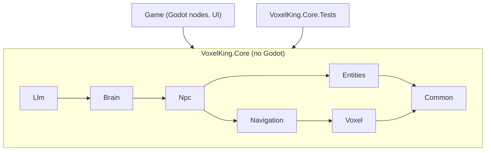
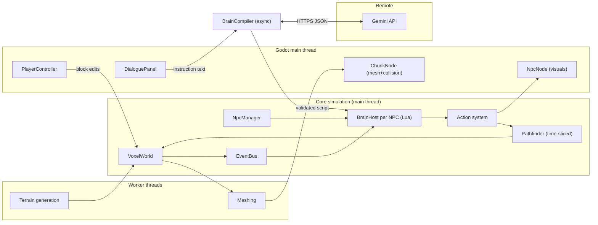
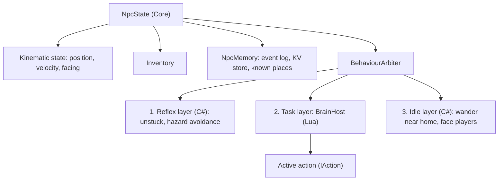

# Architecture — Voxel NPC Game

> Status: **Design / approved for implementation**. This document is the source of truth for
> structure and boundaries. Feature-level work items live in [FEATURES.md](FEATURES.md).
> The Lua contract lives in [LUA_BRAIN_API.md](LUA_BRAIN_API.md), the Gemini contract in
> [LLM_INTEGRATION.md](LLM_INTEGRATION.md).

## 1. Vision

A voxel sandbox in which the player gives NPCs instructions in natural language. An instruction
is sent **once** to a remote LLM (Google Gemini), which returns a **Lua "brain" script**. The
script is validated and then executed by the NPC as classic game AI — every frame, locally,
without further LLM calls — until the player (or an event) replaces it.

```
"Please collect 10 logs and bring them to my chest"
        │  (one LLM call)
        ▼
   Lua brain script  ──►  validated  ──►  runs on the NPC for minutes/hours, zero LLM cost
```

### Core principles

| # | Principle | Consequence |
|---|-----------|-------------|
| P1 | **LLM is a compiler, not a puppeteer** | Exactly one LLM request per player instruction (plus at most N validation retries). |
| P2 | **The LLM never sees the world** | The prompt contains only the API documentation, the NPC profile/memory summary and the instruction. All world knowledge is obtained **at runtime by the NPC** through perception functions. No MCP, no tool calling. |
| P3 | **The script is untrusted** | Player text is part of the prompt → treat generated Lua as hostile. Sandboxed runtime, instruction budgets, no I/O, fixed API surface. |
| P4 | **Fair NPCs** | Perception functions only return what the NPC could plausibly know (radius limits, own memory). No teleporting, no omniscience. |
| P5 | **Engine-independent core** | All simulation logic (voxels, navigation, brain runtime, LLM pipeline) lives in a plain .NET library that does not reference Godot. It is unit-testable without the editor. |
| P6 | **Graceful failure** | Any script error drops the NPC back to a built-in idle behaviour; the game never crashes or freezes because of a script. |

## 2. Technology decisions

| Concern | Decision | Notes |
|---|---|---|
| Engine | **Godot 4.7 (.NET build)**, Forward+, Jolt physics | Project already initialised; must be converted to a C# project (see F-001). |
| Language | **C#** (.NET 8+, same TFM as Godot's SDK) | Nullable reference types enabled. |
| Voxel engine | **Custom**, written in C# | Chunked storage, greedy meshing, threaded mesh building. |
| Scripting | **Lua 5.2 via [MoonSharp](https://www.moonsharp.org/)** | Pure managed C# (no native binaries), built-in sandbox presets, coroutines, `AutoYieldCounter` for instruction budgeting. Wrapped behind `ILuaRuntime` so it can be swapped for NLua later. |
| LLM | **Google Gemini REST API** (`generateContent`) with **structured JSON output** | Model name configurable. Called with `HttpClient`; no SDK dependency required. |
| Tests | **xUnit** for `VoxelKing.Core` | Godot-side features verified with dedicated test scenes. |

## 3. Solution layout

```
voxel-king/
├── project.godot
├── VoxelKing.sln
├── VoxelKing.csproj                 # Godot game assembly (Godot.NET.Sdk) — Godot-dependent code only
├── AGENTS.md                       # Rules for implementing agents
├── docs/                           # Architecture, API & feature docs
├── config/
│   └── game_config.json            # Default configuration (committed)
├── brains/
│   └── examples/*.lua              # Hand-written reference brains (tests, few-shot examples)
├── scenes/                         # .tscn files (main, world, npc, ui, test scenes)
├── assets/                         # textures (block atlas), models, fonts, sounds
├── src/
│   ├── Core/                       # VoxelKing.Core.csproj — NO Godot references
│   │   ├── Common/                 # Vec3i, Vec3, EventBus, ILogger, Config, Rng
│   │   ├── Voxel/                  # BlockRegistry, ChunkData, VoxelWorld, TerrainGenerator, Mesher, persistence
│   │   ├── Navigation/             # Walkability, A* pathfinder, path requests
│   │   ├── Entities/               # EntityId, entity registry, inventory, items
│   │   ├── Npc/                    # NpcState, actions, perception, memory, base behaviours, NpcManager
│   │   ├── Brain/                  # ILuaRuntime, MoonSharp sandbox, API bindings, BrainHost, validator
│   │   └── Llm/                    # ILlmClient, GeminiClient, MockLlmClient, PromptBuilder, BrainCompiler
│   └── Game/                       # Part of VoxelKing.csproj — Godot nodes & glue
│       ├── Bootstrap/              # GameRoot autoload, service wiring
│       ├── World/                  # ChunkNode, mesh upload, collision, chunk streaming
│       ├── Player/                 # First-person controller, block interaction
│       ├── Npc/                    # NpcNode (visuals only; movement is simulated in Core), speech bubbles
│       ├── Entities/               # ItemNode, ItemViewManager (visuals only for dropped items)
│       ├── UI/                     # Dialogue panel, HUD, chat log
│       └── Debug/                  # Brain console, NPC inspector overlay
└── tests/
    └── VoxelKing.Core.Tests/        # xUnit
```

> [!IMPORTANT]
> Godot's root `.csproj` compiles every `*.cs` below the project root by default. `VoxelKing.csproj`
> must contain `<Compile Remove="src/Core/**" />` and `<Compile Remove="tests/**" />` and reference
> `src/Core/VoxelKing.Core.csproj` via `<ProjectReference>`.

### Dependency rule



- `Core` uses its own math types (`Vec3i`, `Vec3`). Conversion to/from `Godot.Vector3` happens only in `Game`.
- `Game` reads simulation state and renders it; it pushes player input into `Core` via services.

## 4. Runtime overview



### 4.1 Simulation ticks

| Loop | Rate | Where | Responsibility |
|---|---|---|---|
| Render / input | per frame | Godot `_Process` | Player camera, UI, interpolation of NPC visuals |
| Physics / movement | 60 Hz | Godot `_PhysicsProcess` → `NpcManager.PhysicsTick` | Player body, NPC kinematic movement, active action ticking |
| Brain tick | 10 Hz (configurable), **staggered** across NPCs | `NpcManager.BrainTick` | Event delivery to Lua handlers, resuming the Lua `main` coroutine |
| Pathfinding | time-sliced, max *X* ms per frame | `PathfindingService` | Processing queued path requests |
| Mesh/generation | async | worker threads | Results applied on the main thread in a per-frame budget |

**NPC level of detail:** NPCs far from every player tick their brain less often (e.g. 2 Hz beyond
64 blocks) and are frozen beyond the loaded chunk radius. All rates are configurable.

### 4.2 Threading model (keep it simple)

- **Single writer:** all mutations of `VoxelWorld`, entities and NPC state happen on the main thread.
- **Workers** receive *copies*: terrain generation produces new `ChunkData`; the mesher receives a
  chunk snapshot plus 1-voxel neighbour borders and returns mesh arrays.
- **Lua runs on the main thread only.** One MoonSharp `Script` instance per NPC.
- **LLM calls** are `async` (`HttpClient`); results are marshalled back to the main thread through a
  `MainThreadDispatcher` queue before touching any NPC.
- **Pathfinding** runs on the main thread, time-sliced with a node budget per frame (no locking needed).
  May be moved to workers later with chunk snapshots.

## 5. Subsystems

### 5.1 Voxel world (`Core/Voxel`, `Game/World`)

- **Coordinates:** 1 block = 1 m, Godot Y-up. Block coordinates are `Vec3i`. Chunk size **32×32×32**
  (configurable constant). World is infinite in X/Z, bounded in Y (e.g. 0..255).
- **BlockRegistry:** blocks identified by string id (`"stone"`, `"oak_log"`) and a compact `ushort`
  runtime id. Properties: solid, transparent, hardness (mining time), drop item, atlas texture indices.
  Defined in data (`config/blocks.json`).
- **ChunkData:** flat `ushort[]` storage, dirty flag, version counter, and a **per-chunk block-type
  index** (counts + positions of "interesting" blocks such as logs, ores, chests) to make
  `world.find_blocks` cheap.
- **TerrainGenerator:** deterministic from seed (noise implemented in Core, e.g. port of FastNoiseLite),
  heightmap + trees + a few resource types.
- **Mesher:** greedy meshing with face culling, texture atlas UVs, separate pass for transparent blocks.
- **ChunkStreaming (Game):** loads/unloads chunks around players, prioritised by distance.
- **Collision (Game):** per-chunk `ConcavePolygonShape3D` built from the mesh (Jolt).
- **Edits:** `VoxelWorld.SetBlock()` → marks chunk + border neighbours dirty → publishes
  `BlockChanged` on the `EventBus` (used by navigation invalidation, perception index, persistence).

### 5.2 Entities & NPCs (`Core/Entities`, `Core/Npc`, `Game/Npc`)



- **NpcManager** owns all NPCs: spawning, ids, tick scheduling/staggering, LOD.
- **BehaviourArbiter:** highest active layer controls the NPC. Reflexes pre-empt the task layer
  temporarily (the running Lua action fails with reason `"interrupted"`); when the task layer has no
  brain (none assigned, finished, or crashed) the idle layer runs.
- **Action system:** `IAction { Start(); ActionStatus Tick(float dt); Cancel(); }` with
  `Running / Succeeded / Failed(reason)`. One *primary* action slot (movement, mining, placing,
  waiting) plus instantaneous overlays (`say`, `look_at`). Actions validate preconditions
  (reach distance, tool, inventory space) and fail with a machine-readable reason string.
- **Perception:** queries scoped by radius (blocks: 24, entities: 32 — configurable) using the
  per-chunk block index and an entity spatial hash. Line-of-sight is a later enhancement.
- **NpcMemory:** ring-buffer event log (heard, said, instructed, task finished, brain error,
  attacked …), Lua-accessible key/value store with size limits, named known places.
- **NpcNode (Game):** visual representation (model, animation, name tag, speech bubble,
  "thinking" indicator). Reads `NpcState` each frame and interpolates. Contains **no** logic.

### 5.3 Navigation (`Core/Navigation`)

- Agent: 0.6 × 1.8 × 0.6 m → occupies 1×2×1 voxels.
- Walkable cell: solid block below, two non-solid blocks at feet and head.
- Moves: 4-directional + diagonals (only if both adjacent cells are clear), step up 1, drop down ≤ 3.
- A* with node budget and max search range (default 64 blocks); returns a **partial path** to the
  closest reached node when the goal is unreachable (`go_to` then fails with `"unreachable"` after
  arriving at the closest point, unless `allow_partial` is set).
- Path following: waypoint steering, stuck detection (no progress for N seconds → re-path, then fail
  with `"stuck"`), invalidation on `BlockChanged` events intersecting the remaining path.

### 5.4 Brain runtime (`Core/Brain`) — see [LUA_BRAIN_API.md](LUA_BRAIN_API.md)

- **LuaSandbox:** MoonSharp `Script` created with a soft-sandbox preset; removed: `io`, `os`, `load`,
  `loadstring`, `dofile`, `require`, `debug`, `string.dump`, `coroutine`, `getmetatable`/`setmetatable`
  on API tables, `rawset/rawget` on globals. The global environment has an `__index` metamethod that
  raises `"unknown global 'x'"` to catch hallucinated APIs early.
- **API bindings:** C# classes annotated with `[LuaApi("description", ...)]`. A `LuaApiRegistry`
  reflects over them to (a) register the functions in the sandbox and (b) **generate the API
  reference text used in the LLM prompt**. One source of truth — documentation and runtime cannot drift.
- **Lua prelude:** blocking actions (`npc.go_to`, `npc.mine`, …) are thin Lua wrappers that call a
  C# `__begin_action(...)` and then `coroutine.yield()`; the host resumes the coroutine with the
  action's result once it completes.
- **BrainHost (per NPC):**
  - runs `main()` as a coroutine with `AutoYieldCounter` = per-tick instruction budget;
  - delivers queued events to optional handlers (`on_heard`, `on_attacked`, …) which must not block;
  - detects runaway scripts (K consecutive forced yields with no action → error `"busy loop"`);
  - on error: logs, records `brain_error` in memory, NPC says a short confused line, arbiter falls
    back to idle. **No automatic LLM re-request** (keeps LLM load low; configurable later).
- **Restartability:** Lua coroutine state is not serialised. On load (or `npc.restart()`) `main()`
  starts again from the top; scripts store progress in `memory`. The prompt instructs the LLM to do so.

### 5.5 LLM pipeline (`Core/Llm`) — see [LLM_INTEGRATION.md](LLM_INTEGRATION.md)

```mermaid
sequenceDiagram
  participant P as Player
  participant UI as DialoguePanel
  participant N as NPC
  participant C as BrainCompiler
  participant G as Gemini
  participant V as BrainValidator
  P->>UI: types instruction
  UI->>N: state = Listening → Thinking (bubble "...")
  UI->>C: CompileAsync(npcContext, text)
  C->>G: generateContent(system prompt + API docs + context + text)
  G-->>C: JSON {reply, needs_clarification, task_summary, script}
  C->>V: Validate(script)
  alt invalid and retries left
    V-->>C: errors
    C->>G: retry with error report
  end
  C-->>N: CompileResult (main thread)
  N->>N: say(reply); if script valid → BrainHost.Swap(script)
```

- **ILlmClient** with `GeminiClient` (real) and `MockLlmClient` (keyword → canned example brain;
  used offline and in tests).
- **LlmRequestQueue:** global concurrency limit (default 2), one in-flight request per NPC (a new
  instruction cancels the previous one), timeout, retry with backoff on 429/5xx, usage logging.
- **BrainValidator:** size limit → compile → global/API check → **dry run against a mock world**
  (bounded resumes, mock actions succeed) → result with human-readable errors fed back to the LLM.

### 5.6 Speech & dialogue

- **SpeechSystem (Core):** `say` publishes `EntitySpoke { speaker, text, position, radius }`.
  Every NPC within radius receives an `on_heard` event; players see a bubble and a chat-log line.
  This already enables simple *scripted* NPC↔NPC interaction without the LLM.
- **Dialogue (Game):** the player looks at an NPC within reach and presses **E** → dialogue panel.
  The NPC pauses its current action, faces the player, and the text is sent to the `BrainCompiler`.
- **Future (not in scope now):** LLM-driven NPC↔NPC conversations and NPCs instructing each other.
  The design keeps this possible: `BrainCompiler` takes an *instructor entity id*, not a player.

### 5.7 Persistence

- `user://saves/<world>/` — `world.json` (seed, time, version), `regions/` (only modified chunks,
  RLE-compressed binary), `npcs.json` (state, inventory, brain source, memory, task summary), `player.json`.
- Versioned formats with a migration hook.

### 5.8 Configuration, logging & debugging

- `config/game_config.json` (committed defaults) merged with `user://config.json` (local overrides,
  **contains the Gemini API key**, never committed). Env var `GEMINI_API_KEY` overrides both.
- `ILogger` in Core, routed to Godot's output in Game, and to files in `user://logs/`. LLM requests
  and responses are logged in full to `user://logs/llm/` for prompt debugging.
- **Brain console (debug):** select an NPC and apply a Lua script directly (from file or text),
  bypassing the LLM. This is the primary tool to develop the runtime before the LLM is integrated.
- **NPC inspector overlay (F3):** current layer, action, path line, brain log output, instruction budget
  usage, last error, last prompt/response, and token usage totals.

## 6. Security notes

- Generated Lua is untrusted: sandbox + budgets + fixed API is the security boundary. Add sandbox
  escape tests (F-304) and keep the forbidden-globals list in one place.
- MoonSharp has no hard memory limit → mitigate with string length caps in API calls, KV-store size
  caps, table-size checks in `memory.set`, and the busy-loop detector. Re-evaluate if abuse appears.
- **API key:** shipping a Gemini key in a client build is insecure. Acceptable for development; a
  relay backend is required before any public release (tracked as a future feature).

## 7. Out of scope (for now)

- LLM-driven NPC↔NPC conversation (planned, see 5.6)
- Multiplayer / networking
- Combat system beyond simple damage events, crafting, day/night gameplay effects
- Relay server for the API key
