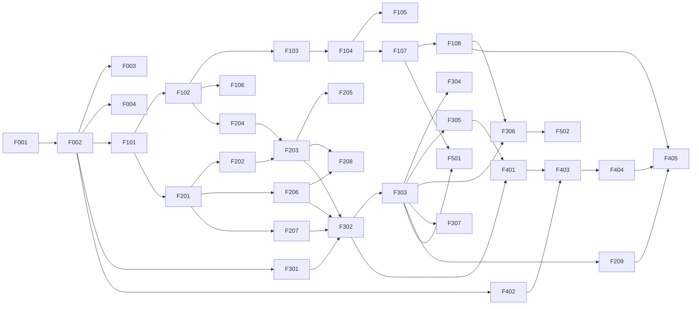

# Feature Backlog

> Work items for implementing agents. Each feature is sized to be done by one agent in one session.
> Read [ARCHITECTURE.md](ARCHITECTURE.md) first. Respect the dependency column — do not start a
> feature before its dependencies are **Done**. Update the status column when you start/finish.
> Find Godot and dotnet dependencies in the readme
> Status: `Todo` · `In progress (<agent/branch>)` · `Done` · `Blocked (<reason>)`

## Milestone overview

| Milestone | Goal | Demo at the end |
|---|---|---|
| **M0 Foundation** | Buildable C# solution, Core library, tests, config, logging | `dotnet test` green, empty scene runs |
| **M1 Voxel world** | Explorable, editable voxel terrain with a first-person player | Walk around, break/place blocks |
| **M2 NPCs** | Multiple NPCs with movement, pathfinding, actions, perception, memory | NPCs idle-wander; debug command makes one walk somewhere and mine |
| **M3 Lua brains** | Sandboxed Lua runtime driving NPCs | Apply example brains via debug console; NPCs gather logs autonomously |
| **M4 LLM** | Natural-language instructions through Gemini | Talk to an NPC, it does what you asked |
| **M5 Persistence & polish** | Save/load, inspector, UX polish | Quit & reload, NPCs continue their tasks |

## Summary table

| ID | Feature | Milestone | Depends on | Status |
|---|---|---|---|---|
| F-001 | Convert project to Godot .NET / C# solution | M0 | – | Done |
| F-002 | Core library + test project + solution layout | M0 | F-001 | Done |
| F-003 | Configuration system | M0 | F-002 | Done |
| F-004 | Logging, EventBus, MainThreadDispatcher | M0 | F-002 | Done |
| F-101 | Block registry & chunk data | M1 | F-002 | Done |
| F-102 | Terrain generation | M1 | F-101 | Done |
| F-103 | Chunk meshing (greedy, atlas) | M1 | F-102 | Done |
| F-104 | Chunk streaming & rendering in Godot | M1 | F-103 | Done |
| F-105 | Chunk collision | M1 | F-104 | Done |
| F-106 | Per-chunk block-type index | M1 | F-102 | Done |
| F-107 | First-person player controller | M1 | F-105 | Done |
| F-108 | Player block interaction & inventory | M1 | F-107 | Done |
| F-201 | Entity registry, NPC state & NpcManager | M2 | F-101 | Done |
| F-202 | NPC node, visuals & kinematic movement | M2 | F-201, F-104 | Done |
| F-203 | Voxel pathfinding & path following | M2 | F-202, F-204 | Done |
| F-204 | Walkability queries | M2 | F-102 | Done |
| F-205 | Action system | M2 | F-203 | Done |
| F-206 | Perception service | M2 | F-201, F-106 | Done |
| F-207 | NPC memory | M2 | F-201 | Done |
| F-208 | Behaviour arbiter, idle & reflex layers | M2 | F-205, F-206 | Done |
| F-209 | Speech system & speech bubbles | M3 | F-303 | Done |
| F-301 | Lua sandbox (MoonSharp) | M3 | F-002 | Done |
| F-302 | Lua API registry & bindings | M3 | F-301, F-205, F-206, F-207 | Done |
| F-303 | BrainHost (coroutines, budgets, handlers) | M3 | F-302 | Done |
| F-304 | Sandbox security test suite | M3 | F-303 | Done |
| F-305 | Example brain library | M3 | F-303 | Done |
| F-306 | Debug brain console | M3 | F-303, F-108 | Done |
| F-307 | Brain validator (compile + dry run) | M3 | F-303 | Done |
| F-401 | Prompt builder | M4 | F-302, F-305 | Done |
| F-402 | LLM client abstraction, Gemini & mock clients | M4 | F-002 | Todo |
| F-403 | LLM request queue | M4 | F-402 | Todo |
| F-404 | BrainCompiler (generate → validate → repair) | M4 | F-401, F-403, F-307 | Todo |
| F-405 | Dialogue UI & NPC conversation states | M4 | F-108, F-404, F-209 | Todo |
| F-406 | Spawn multiple NPCs with profiles | M4 | F-208 | Todo |
| F-501 | Save / load | M5 | F-107, F-303 | Todo |
| F-502 | NPC inspector overlay | M5 | F-306 | Todo |
| F-503 | Day/night cycle & world time | M5 | F-104 | Todo |

---

## M0 — Foundation

### F-001 Convert project to Godot .NET / C# solution
- **Prerequisites (human):** install the .NET SDK (8 or newer, matching Godot 4.7's requirement) and the
  **Godot 4.7 .NET** editor build.
- Create `VoxelKing.csproj` (Godot.NET.Sdk) and `VoxelKing.sln`; enable nullable + `TreatWarningsAsErrors` for Core.
- Add `.gitignore` entries for `bin/`, `obj/`, `.vs/`, `*.user`, `user://`-equivalent local configs.
- Create a `scenes/main.tscn` with a `GameRoot` C# node that logs "started".
- **Done when:** the project opens in Godot .NET, builds, and the main scene runs and prints the log line.

### F-002 Core library + test project + solution layout
- Create the folder structure from ARCHITECTURE §3. `src/Core/VoxelKing.Core.csproj` (no Godot reference),
  `tests/VoxelKing.Core.Tests` (xUnit). Exclude both from the Godot csproj compile glob, add `ProjectReference`.
- Implement `Vec3i` and `Vec3` (equality, hashing, arithmetic, conversions in Game via extension methods).
- **Done when:** `dotnet build` and `dotnet test` succeed from the repo root; Godot build still works; one
  sample test for `Vec3i` exists.

### F-003 Configuration system
- `GameConfig` POCO tree (world, npc, brain limits, llm, debug) loaded from `config/game_config.json`, merged
  with `user://config.json`, env var `GEMINI_API_KEY` override.
- Core receives config through a constructor-injected interface (no static globals).
- **Done when:** values from all three sources merge correctly (unit-tested); missing user config is fine.

### F-004 Logging, EventBus, MainThreadDispatcher
- `ILogger` with categories and levels; Godot sink (`GD.Print/PushWarning/PushError`) and file sink.
- Typed, synchronous `EventBus` (`Publish<T>`, `Subscribe<T>`, unsubscribe via `IDisposable`).
- `MainThreadDispatcher`: thread-safe queue drained each frame with a time budget.
- **Done when:** unit tests cover subscription/unsubscription and dispatcher ordering.

## M1 — Voxel world

### F-101 Block registry & chunk data
- `config/blocks.json` → `BlockRegistry` (string id ↔ `ushort`, solid, transparent, hardness, drop, atlas indices).
- Initial blocks: air, grass, dirt, stone, sand, water (non-solid, transparent), oak_log, oak_leaves, planks,
  cobblestone, chest (container), coal_ore.
- `ChunkData` (32³, flat `ushort[]`), `VoxelWorld` (chunk dictionary, `GetBlock/SetBlock` in world coords,
  publishes `BlockChanged`, marks neighbours dirty on border edits).
- **Done when:** unit tests for coordinate conversion (incl. negatives), get/set, border-dirty logic.

### F-102 Terrain generation
- Deterministic `TerrainGenerator(seed)` running on worker threads: heightmap noise, grass/dirt/stone layers,
  sand near water level, trees, coal ore. Noise implementation in Core (no Godot `FastNoiseLite`).
- **Done when:** same seed ⇒ identical chunks (test); generation of a chunk < 5 ms on dev machine (benchmark logged).

### F-103 Chunk meshing
- Greedy mesher producing vertex/normal/UV/index arrays (Core types) with face culling against neighbours.
  Separate transparent submesh. Texture atlas in `assets/textures/blocks_atlas.png` (generate placeholder
  art with clear per-block colours if no art exists).
- **Done when:** unit tests for face counts on simple shapes; meshing runs on workers.

### F-104 Chunk streaming & rendering
- `ChunkStreamer` loads/generates/meshes chunks within a configurable radius around the player, unloads
  beyond radius + hysteresis, prioritises closest; applies results in a per-frame budget via the dispatcher.
- `ChunkNode` (`MeshInstance3D`) with shared material.
- **Done when:** flying around keeps a stable frame rate, no holes at chunk borders, edits re-mesh within one frame budget.

### F-105 Chunk collision
- Build `ConcavePolygonShape3D` from the opaque solid mesh for each chunk (`StaticBody3D`); rebuild on edit.
- **Done when:** a `CharacterBody3D` can walk on terrain and collide with walls; no falling through after edits.

### F-106 Per-chunk block-type index
- Maintain per chunk: counts per block type and position lists for "indexed" block types (flag in blocks.json:
  logs, ores, chest, …). Updated on generation and `SetBlock`.
- API: `FindNearest(blockId, origin, radius)`, `FindAll(blockId, origin, radius, max)` scanning only chunks
  that contain the type.
- **Done when:** unit tests verify results equal a brute-force scan; query over radius 24 < 0.2 ms typical.

### F-107 First-person player controller
- `CharacterBody3D`, mouse look, WASD, jump, sprint, fly toggle (debug). Spawns on surface.
- **Done when:** smooth movement over terrain, step handling acceptable, mouse capture toggles with Esc.

### F-108 Player block interaction & inventory
- Voxel raycast (DDA) in Core; highlight targeted block; LMB break (with hardness time), RMB place selected
  block; simple hotbar inventory UI.
- Player can open a chest (simple container UI) and mark it — **"Mark as my chest"** sets the named place
  `player_chest` for nearby NPCs (needed by example brains). *(Simple keybind is acceptable.)*
- **Done when:** blocks can be broken/placed reliably, drops go into inventory, chests store items.

## M2 — NPCs

### F-201 Entity registry, NPC state & NpcManager
- `EntityId`, `EntityRegistry` with spatial hash for fast radius queries; entity kinds player/npc/item/animal.
- `NpcState` (id, name, profile, position, velocity, facing, health, inventory, home).
- `NpcManager`: spawn/despawn, physics tick, staggered brain tick scheduling, distance-based LOD rates.
- Item entities (dropped items) with pickup.
- **Done when:** unit tests for spatial hash queries and tick staggering (N NPCs spread evenly over ticks).

### F-202 NPC node, visuals & kinematic movement
- `NpcNode` scene: simple low-poly/blocky humanoid (placeholder mesh acceptable), name tag, walk/idle
  animation, interpolated from `NpcState`.
- Kinematic movement in Core (gravity, collision against voxels via AABB sweep — do not depend on Godot
  physics so the simulation stays in Core), jumping one block.
- **Done when:** debug-spawned NPC stands on terrain, can be moved by a debug command, collides properly.

### F-203 Voxel pathfinding & path following
- Implement ARCHITECTURE §5.3: A* with budget, partial paths, time-sliced `PathfindingService`, path follower
  with stuck detection, invalidation on `BlockChanged`.
- Debug draw of the current path (Game side).
- **Done when:** unit tests on handcrafted worlds (stairs, gaps, walls, unreachable goals); in-game NPC
  navigates around trees and up hills.

### F-204 Walkability queries
- `Walkability.IsWalkable(pos)`, `Neighbours(pos)` with step-up/drop rules, `Surface(x, z)`.
- **Done when:** unit tests cover all move rules.

### F-205 Action system
- `IAction` + implementations: `GoTo`, `GoNear`, `Follow`, `Mine`, `Place`, `PickUp`, `Drop`, `Give`,
  `Deposit`, `Withdraw`, `Wait`; overlays `Say`, `LookAt`. Each has timeout, cancel, precondition checks and
  returns the failure reasons listed in LUA_BRAIN_API §2.
- Container support (chest inventory) in Core.
- **Done when:** unit tests per action (success + each failure reason) using a test world.

### F-206 Perception service
- Implements the `world.*` semantics (radius limits, nil outside radius) on top of F-106 and the entity spatial hash.
- **Done when:** unit tests verify radius limits and nearest-first ordering.

### F-207 NPC memory
- Event log ring buffer (typed events + timestamps + text rendering for prompts), KV store with limits and
  value-type validation, named places.
- **Done when:** unit tests for limits, serialisation round-trip, event rendering.

### F-208 Behaviour arbiter, idle & reflex layers
- Arbiter with layers Reflex > Task > Idle. Idle: wander within 8 blocks of home, look at nearby players.
  Reflex: get unstuck (no progress), avoid water/drops > 3, step out of blocks it is suffocating in.
  Task layer is a stub interface until F-303.
- **Done when:** several NPCs idle-wander naturally without getting stuck for 10+ minutes.

### F-209 Speech system & speech bubbles
- Core `SpeechSystem`: `EntitySpoke` broadcast, hearing radius, rate limiting, delivery as `on_heard` events
  to brains. Game: speech bubble above NPC (fade out), chat log panel.
- **Done when:** an NPC brain `say` is visible as a bubble and other brains receive `on_heard`.

## M3 — Lua brains

### F-301 Lua sandbox (MoonSharp)
- Add MoonSharp NuGet to Core. `ILuaRuntime` abstraction; `MoonSharpRuntime` creating sandboxed `Script`
  instances (ARCHITECTURE §5.4 removal list, unknown-global trap, deterministic `random`).
- **Done when:** sandbox creation tested; forbidden globals are absent; unknown global access errors.

### F-302 Lua API registry & bindings
- `[LuaApi]` attribute (name, description, params, returns, blocking flag, allowed-in-handler flag).
- `LuaApiRegistry` registers bindings and generates the Markdown/plaintext API reference.
- Bindings for all functions in LUA_BRAIN_API §3; Lua prelude with yielding wrappers; `pos` metatable.
- **Done when:** every function in the spec is bound (test enumerates spec ↔ registry); generated reference
  snapshot test.

### F-303 BrainHost
- Coroutine execution of `main`, per-tick instruction budget (`AutoYieldCounter`), action wait/resume,
  `npc.wait` timers, event queue → handlers with budget, blocking-in-handler error, busy-loop detection,
  `done/restart/interrupt`, error → idle fallback + memory event. Hook into arbiter's task layer.
- **Done when:** unit tests with a fake NPC/world cover all lifecycle rows in LUA_BRAIN_API §1 and limits in §4;
  20 NPCs running brains cost < 1 ms per brain tick total on dev machine.

### F-304 Sandbox security test suite
- Tests attempting escapes: `load`, `string.dump`, metatable tricks on `_G`/API tables, `debug`, huge string
  allocation, deep recursion, infinite loops in top-level/handlers/main, yield from handlers.
- **Done when:** all attempts fail safely without crashing or hanging the host.

### F-305 Example brain library
- `brains/examples/` with header comments (`-- instruction:` and `-- reply:`): `gather_logs.lua`,
  `follow_player.lua`, `guard_area.lua`, `build_wall.lua`, `farm_loop.lua`, `go_home_at_night.lua`,
  `deliver_items.lua`, plus `invalid/` broken samples (syntax error, unknown API, busy loop, blocking in handler).
- **Done when:** every valid example runs in-game without errors for 5 minutes; invalid ones are rejected by F-307.

### F-306 Debug brain console
- Toggle with F2: select NPC (looked-at or from list), load example file or paste Lua, apply directly
  (through validator), show validation errors and brain log output.
- **Done when:** a developer can assign any example brain to any NPC at runtime.

### F-307 Brain validator
- Implements LLM_INTEGRATION §4 stages 2–6 with `MockWorld`.
- **Done when:** valid examples pass, each invalid example fails at the expected stage with a useful message.

## M4 — LLM

### F-401 Prompt builder
- Builds system instruction (rules + generated API reference + few-shot examples) and user content (NPC
  context per LLM_INTEGRATION §2.2). Token-size estimate; trims events/conversation to fit a budget.
- **Done when:** snapshot tests for a sample NPC; system part is identical between calls (cacheable).

### F-402 LLM client abstraction, Gemini & mock clients
- `ILlmClient.GenerateAsync(LlmRequest, CancellationToken)`; `GeminiClient` (REST, structured output with
  `responseSchema`, usage parsing, error mapping); `MockLlmClient` (keyword → example brain).
- Auto-fallback to mock with HUD warning when no API key is configured.
- **Done when:** response parsing unit-tested with recorded JSON fixtures; manual smoke test against Gemini succeeds.

### F-403 LLM request queue
- Concurrency limit, rate limit, per-NPC cancellation, timeout, retry/backoff, usage stats, file logging.
- **Done when:** unit tests with a fake client cover cancellation, retries and concurrency.

### F-404 BrainCompiler
- Orchestrates prompt → request → parse → validate → repair retries → `CompileResult` dispatched to main
  thread → apply per LLM_INTEGRATION §3 handling table; stores `task_summary` and instruction in memory.
- **Done when:** end-to-end test with mock client (valid, invalid-then-repaired, invalid-exhausted, clarification).

### F-405 Dialogue UI & NPC conversation states
- Look at NPC within 4 blocks + **E** → dialogue panel (text input, recent conversation). NPC states:
  Listening (faces player, pauses action), Thinking (animated "…" bubble), Replying. Esc cancels.
  Other NPCs can be instructed while one is thinking.
- **Done when:** full loop works in-game with mock and with Gemini.

### F-406 Spawn multiple NPCs with profiles
- `config/npcs.json`: name, personality, skills, appearance colour, home offset. Spawn N NPCs near the player
  start; distinct appearance/name tags. Profiles feed the prompt.
- **Done when:** ≥ 5 NPCs run independently with different brains at stable frame rate.

## M5 — Persistence & polish

### F-501 Save / load
- ARCHITECTURE §5.7. Autosave interval + save on quit; load on start (menu optional).
- **Done when:** modified terrain, inventories, chests, NPC positions, brains (restarted) and memory survive restart.

### F-502 NPC inspector overlay
- Toggle with F3 on looked-at NPC: layer, action, path, inventory, memory KV, recent events, brain log,
  budget usage, last error, last prompt/response, token usage totals.
- **Done when:** all fields update live.

### F-503 Day/night cycle & world time
- World clock (configurable day length), sun/sky, `world.time()` / `world.is_day()` backed by it.
- **Done when:** example `go_home_at_night.lua` behaves correctly.

---

## Future (not scheduled)

| Feature | Notes |
|---|---|
| LLM-driven NPC↔NPC conversation | NPCs use `npc.tell` / `on_told`; conversation turns via LLM with strict budgets |
| `npc.ask()` escalation | Brain can request a new LLM compile when stuck (rate-limited) |
| API-key relay backend | Required before public release |
| Line-of-sight perception | Raycast-based visibility for entities |
| Prompt evaluation tool | `tools/PromptEval`: batch-run `tests/prompts/instructions.txt` through Gemini, report pass rate/tokens |
| Multiplayer | Out of scope for current architecture iteration |
